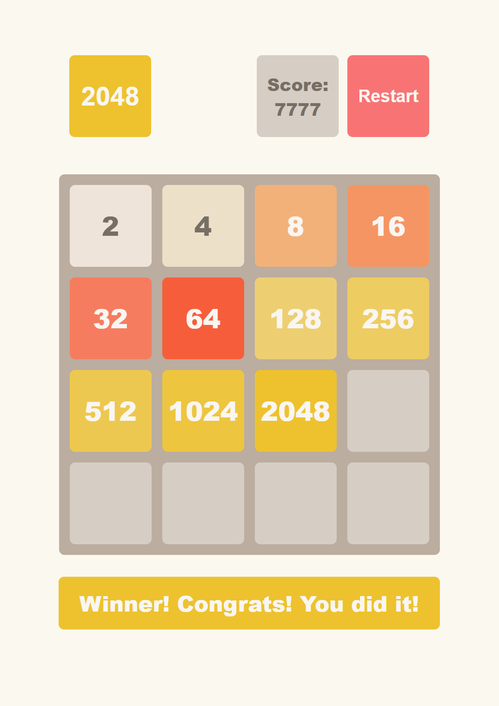

# 2048 game

Hey! Are you ready for a real hard check of your JavaScript skills, ninja?
If you are still here, let's do it.

In this task, you need to implement the 2048 game like in [this reference](https://play2048.co/)
Don't play for too long! We need you to write the code!

Okay, what do we have?
1) HTML and CSS are already written. You can use it, or implement your own design if you want.
2) Base `Game` class structure is already written too. Extend it with your own methods. Obligatory methods (used in tests):
  - constructor with `initialState` parameter (value is optional, defaults to the empty board)
  - `getState()`
  - `getScore()`
  - `getStatus()`
  - `moveLeft()`
  - `moveRight()`
  - `moveUp()`
  - `moveDown()`
  - `start()`
  - `restart()`

3) Reference.

That's it!

Okay, okay. Also, we have some rules:
1) The game field is 4 x 4
2) Each cell can be empty or contain one of the numbers: 2, 4, 8 ... 2^n
3) The player can move cells with keyboard arrows
4) All the numbers should be moved in the selected direction until all empty cells are filled in
   - 2 equal cells should be merged into a doubled number
   - The merged cell can’t be merged twice during one move
5) The move is possible if at least one cell is changed after the move
6) After move 2 or 4 appears in a random empty cell. 4 probability is 10%
7) When 2048 value is displayed in any cell, win message should be shown.
8) The `game over` message should be shown if there are no more available moves.
9) Hide start message when game starts.
10) Change the `Start` button to `Restart` after the first move.
11) `Restart` button should reset the game to the initial state.
12) Increase score with each move. The score should be increased by the sum of all merged cells.
13) The game consists of 2 main parts:
  - game logic written in `src/modules/Game.class.js` module that exports `Game` class
  - game UI written in `src/index.html` with `main.js` script that need to use `Game` class instance

Hints:
- You have class `field-cell--%cell_value%`, for styling cell in the game.
- Use `hidden` class for hiding elements on page.
- Use `start`, `restart` classes for the main button for different styles.
- Use `field-cell--%cell_value%` class like additional class, don't replace the main class.
- Use `keydown` event and `event.key` property to handle arrow buttons presses
    ```js
    document.addEventListener('keydown', event => console.log(event.key));
    ```
- Adding animation to the game is optional. It is a bit tricky, but you can try it if you want. Probably, you will need to extend the Game class with additional methods and create a separate board storage with Tile entities to operate their corresponding DOM elements' positions.

You can change the HTML/CSS layout if you need it.



## Deploy and Pull Request

1. Replace `<your_account>` with your Github username in the link
    - [DEMO LINK](https://<your_account>.github.io/js_2048_game/)
2. Follow [this instructions](https://mate-academy.github.io/layout_task-guideline/)
    - Run `npm run test` command to test your code;
    - Run `npm run test:only -- -n` to run fast test ignoring linter;
    - Run `npm run test:only -- -l` to run fast test with additional info in console ignoring linter.


HTML и CSS уже написаны. Ты можешь использовать их или создать свой собственный дизайн, если хочешь.

Базовая структура класса Game тоже уже написана. Расширь её своими методами. Обязательные методы (используются в тестах):

конструктор с параметром initialState (необязательный, по умолчанию пустое поле)

getState()

getScore()

getStatus()

moveLeft()

moveRight()

moveUp()

moveDown()

start()

restart()

Эталон (референс).

Всё!

Ладно-ладно. Есть ещё несколько правил:

Игровое поле — 4 × 4.

Каждая ячейка может быть пустой или содержать одно из чисел: 2, 4, 8 ... 2^n.

Игрок может двигать плитки стрелками на клавиатуре.

Все числа должны двигаться в выбранном направлении до упора, пока пустые клетки не будут устранены:

две одинаковые плитки должны объединяться в удвоенное число

объединённая плитка не может объединяться второй раз за один ход

Ход считается возможным, если после него хотя бы одна плитка изменила положение.

После каждого хода появляется новая плитка 2 или 4 в случайной пустой клетке. Вероятность появления 4 — 10%.

Если в любой клетке появляется значение 2048 — показать сообщение о победе.

Показать сообщение game over, если больше нет доступных ходов.

Скрыть сообщение start message, когда игра начинается.

Кнопка Start должна стать Restart после первого хода.

Кнопка Restart должна полностью сбрасывать игру в исходное состояние.

Увеличивать счёт после каждого хода. Счёт увеличивается на сумму всех объединённых плиток.

Игра состоит из двух основных частей:

игровая логика в src/modules/Game.class.js, экспортирующая класс Game

игровой UI в src/index.html и main.js, который использует экземпляр класса Game