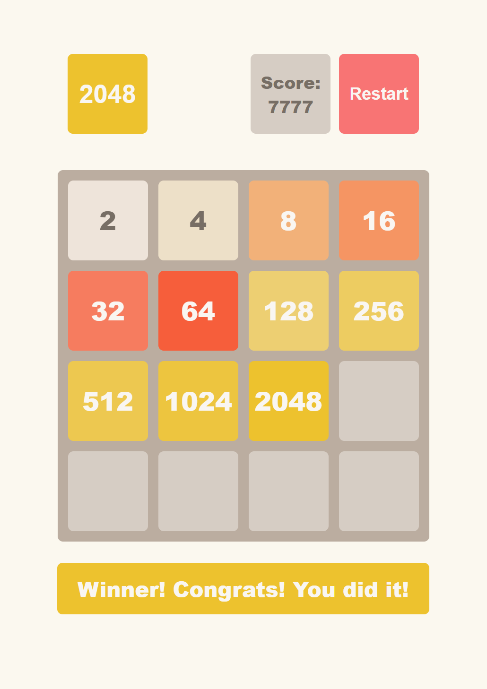
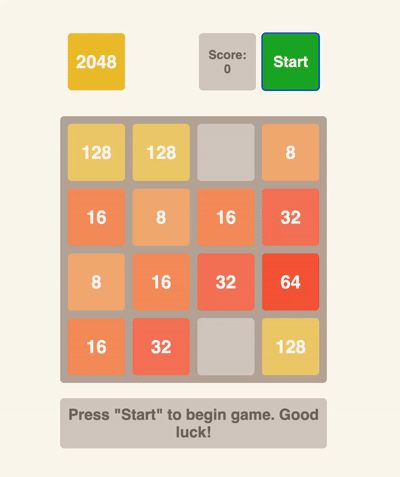

# 2048

A browser version of the classic **2048** puzzle game, built from scratch with vanilla JavaScript. Slide the tiles, merge equal numbers, and try to create the **2048** tile before the board fills up.

[**Live demo**](https://yJorJio-svg.github.io/your-repo/) · [Report a bug](https://github.com/your-username/your-repo/issues)





## About the game

2048 is played on a 4×4 board. Every move slides all tiles as far as possible in the chosen direction. When two tiles with the same number collide, they merge into one tile with double the value, and the merged value is added to your score.

### How to play

- Use the **arrow keys** to move tiles up, down, left, or right.
- Equal tiles that touch merge into one (`2 + 2 = 4`, `4 + 4 = 8`, ...).
- After every valid move, a new tile (`2` with 90% chance, `4` with 10%) appears in a random empty cell.
- Press **Start** to begin and **Restart** to reset the board and score.

### Rules implemented

- A move counts only if at least one cell changes. Otherwise nothing happens and no tile spawns.
- A tile can merge only once per move, so `[2, 2, 2, 2]` becomes `[4, 4, 0, 0]`, not `[8, 0, 0, 0]`.
- **Win:** a `2048` tile appears on the board.
- **Lose:** the board is full and no merges are possible in any direction.
- The score increases by the value of every tile created by a merge.

## Features

- Full game logic: sliding, merging, score tracking, win and lose detection
- Game states: `idle`, `playing`, `win`, `lose`
- Animations for new tiles, merged tiles, and win/lose messages
- Respects `prefers-reduced-motion`: animations are skipped for users who turn motion off in their system settings
- Color-coded tiles, one style per value
- Game logic separated from rendering, which makes it easy to test
- Automated checks: unit tests with Jest and end-to-end tests with Cypress on every pull request

## Technologies

| Technology            | Purpose                                                                                                               |
| --------------------- | --------------------------------------------------------------------------------------------------------------------- |
| **HTML5**             | Page structure and the game board (a semantic `<table>`)                                                              |
| **SCSS**              | Styling with nesting, mixins, and animation keyframes                                                                 |
| **JavaScript (ES6+)** | Game logic and DOM rendering: classes, static members, array methods, CommonJS modules (`require` / `module.exports`) |
| **Node.js**           | Runtime for the toolchain and npm scripts                                                                             |
| **Parcel**            | Zero-config bundler with a dev server, SCSS compilation, and production builds                                        |
| **Jest**              | Unit tests for the game logic                                                                                         |
| **Cypress**           | End-to-end tests that play the game in a real browser                                                                 |
| **GitHub Actions**    | Runs the Cypress tests automatically on every pull request                                                            |
| **ESLint**            | JavaScript linting                                                                                                    |
| **Stylelint**         | SCSS linting                                                                                                          |
| **Prettier**          | Code formatting                                                                                                       |

## Architecture

The project is split into two parts with separate responsibilities:

| File            | Responsibility                                                                                                       |
| --------------- | -------------------------------------------------------------------------------------------------------------------- |
| `Game.class.js` | Game logic: board state, moves, merging, score, win/lose detection. Contains no DOM code.                            |
| `main.js`       | Rendering and input: reads the game state, updates the table and CSS classes, handles button clicks and key presses. |

`main.js` never changes the board itself. It calls methods on a `Game` instance (`start()`, `moveLeft()`, `restart()`, ...) and then redraws the page from `getState()`, `getScore()` and `getStatus()`.

This separation keeps the rules independent of the UI, so the game logic can be unit tested without a browser and the interface can be restyled or rewritten without touching the game rules.

### The `Game` class

#### Instance methods

| Method                                                   | Responsibility                                                    |
| -------------------------------------------------------- | ----------------------------------------------------------------- |
| `start()` / `restart()`                                  | Begin a new game or reset to the initial state                    |
| `moveLeft()` / `moveRight()` / `moveUp()` / `moveDown()` | Handle a move and report whether the board changed                |
| `shiftRow()`                                             | Pack tiles toward one side, removing gaps                         |
| `mergeRow()`                                             | Merge equal neighbors, one merge per tile                         |
| `shiftColumns()`                                         | Shift all columns of the board up or down, removing gaps          |
| `mergeColumns()`                                         | Merge equal neighbors in all columns, reusing the row merge logic |
| `addRandomTile()`                                        | Spawn a `2` or `4` in a random empty cell                         |
| `isGameWon()` / `isGameOver()`                           | Detect the win and lose conditions                                |
| `getState()` / `getScore()` / `getStatus()`              | Read-only access for the renderer                                 |

Vertical moves reuse the row logic: each column is extracted, processed as a row, and written back.

#### Static helper methods

These helpers don't depend on any particular game instance (they never use this). copyState works only with the board that is passed to it as an argument, so they belong to the class itself and are called as `Game.createEmptyField()` and `Game.copyState(state)`.

| Method                    | Responsibility                                                                |
| ------------------------- | ----------------------------------------------------------------------------- |
| `Game.createEmptyField()` | Create a two-dimensional array filled with zeros                              |
| `Game.copyState(state)`   | Deep copy of a game field, so the original board is never changed by accident |

### Constants

Shared values are stored as static properties on the class instead of raw strings scattered through the code. `Object.freeze` prevents accidental changes, and a misspelled name such as `Game.STATUS.PLAYNG` is `undefined`, so the mistake is easy to spot instead of hiding inside a string.

| Constant               | Values                           | Purpose                                          |
| ---------------------- | -------------------------------- | ------------------------------------------------ |
| `Game.GOAL_OF_VICTORY` | `2048`                           | The tile value that wins the game                |
| `Game.DIRECTION`       | `LEFT`, `RIGHT`, `UP`, `DOWN`    | Directions passed to the shift and merge methods |
| `Game.STATUS`          | `IDLE`, `PLAYING`, `WIN`, `LOSE` | The possible states of the game                  |

## Project structure

```
.
├── .github/                 # GitHub Actions workflows
├── cypress/                 # end-to-end tests
├── src
│   ├── images/
│   ├── modules
│   │   └── Game.class.js    # game logic
│   ├── scripts
│   │   └── main.js          # rendering and input handling
│   ├── styles
│   │   └── main.scss        # styles and animations
│   └── index.html
├── tests
│   └── Game.class.test.js   # Jest unit tests
├── cypress.config.js
├── jest.config.js
├── package.json
├── LICENSE
└── README.md
```

## Getting started

### Prerequisites

- [Node.js](https://nodejs.org/) (LTS version recommended)
- npm (comes with Node.js)

### Installation and run

```bash / zsh
git clone https://github.com/your-username/your-repo.git
cd your-repo
git checkout develop   # all development happens on the develop branch
npm install            # installs the dependencies from package.json
npm start              # starts the dev server and opens the game in your browser
```

Parcel serves the game with hot reload, so the page updates as you edit the code. If the browser doesn't open on its own, use the address printed in the terminal (usually `http://localhost:1234`).

## Deployment

The game is published with GitHub Pages. To deploy the latest version, run:

```bash / zsh
npm run deploy
```

The live demo is available at the link at the top of this README.

## Testing

```bash / zsh
npm test
```

`npm test` runs the full check in two steps:

1. **Linting and formatting:** Stylelint and Prettier for the SCSS and HTML, then the project linter for the JavaScript.
2. **End-to-end tests (Cypress):** the game is opened in a real (headless) browser and played like a user would. The tests check the initial score, moves in all directions, resetting the score, and the message shown when the player loses.

When the run finishes, a test report is generated in `reports/report.html` and opens in the browser, showing which tests passed or failed.

The same checks run automatically through GitHub Actions on every pull request, so changes are verified before they are merged.

### Unit tests (Jest)

The game logic is also covered by unit tests in `tests/Game.class.test.js`, which test the `Game` class directly with no browser needed. Jest itself is installed with the other dependencies by `npm install`. To run and debug the tests from VS Code, install the [Jest extension] separately; it picks up the project's `jest.config.js` automatically.

## Reference

The game is based on the original 2048: [play2048.co](https://play2048.co/)

## Author

GitHub: [@JorJio-svg](https://github.com/JorJio-svg)
